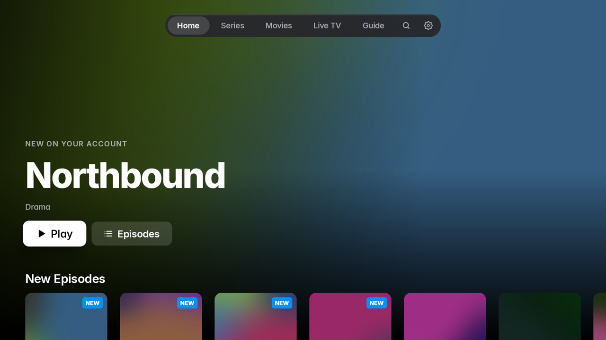
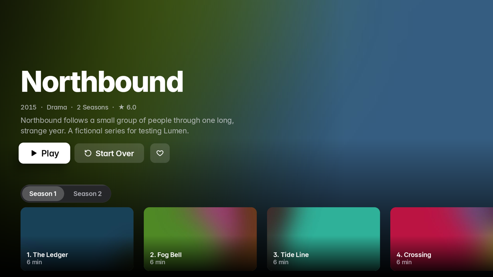
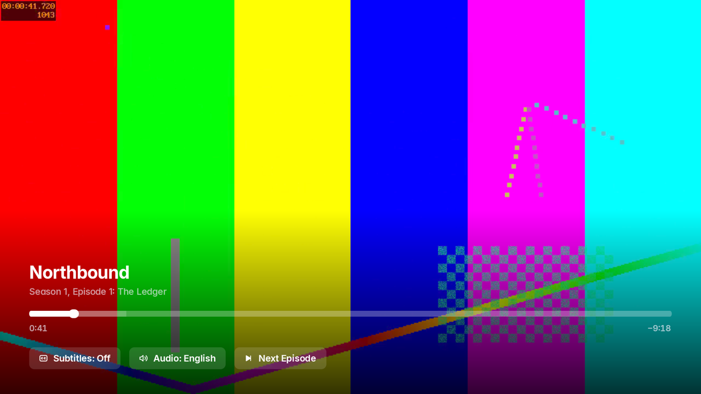
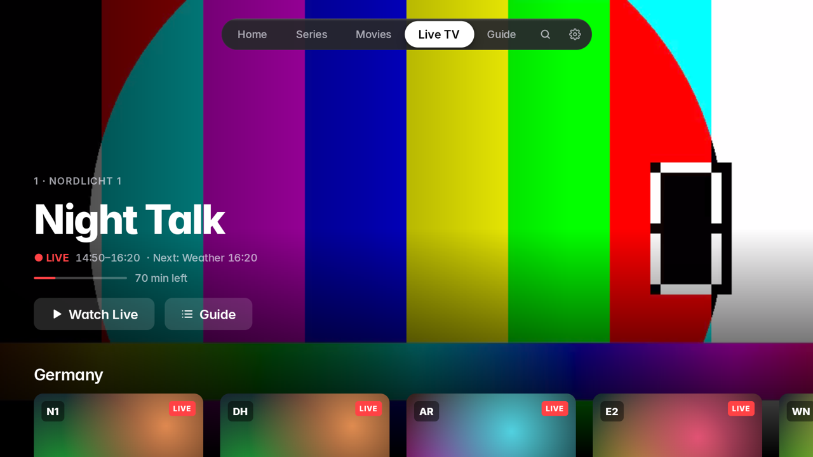
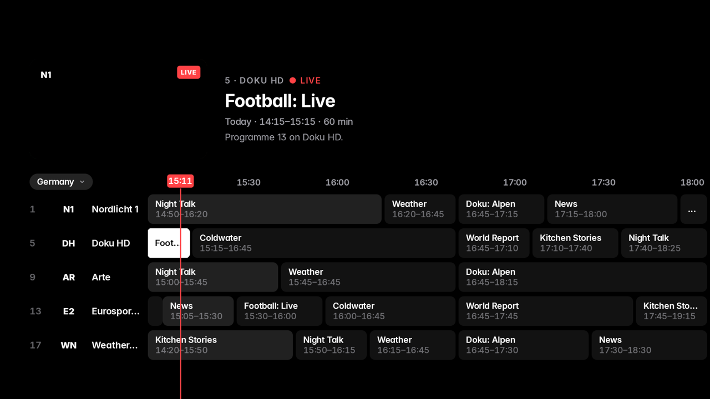
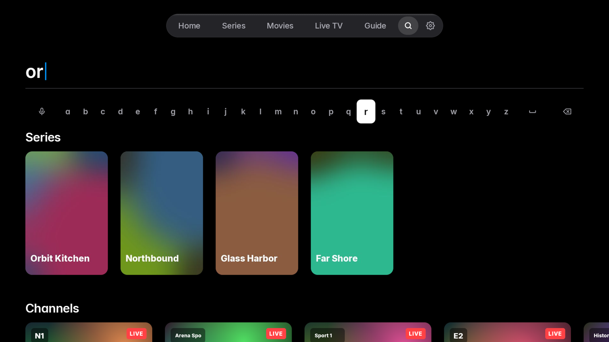
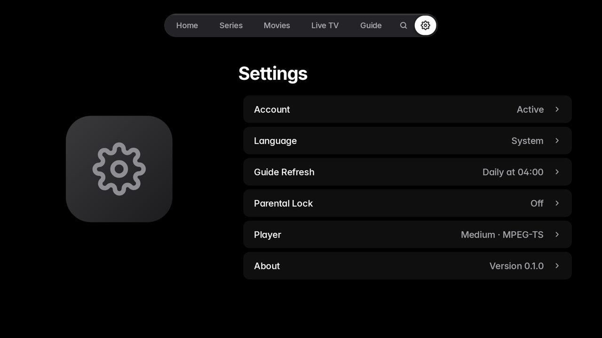

# Lumen

A personal IPTV player for Google TV and Fire TV that looks and moves like an Apple TV app.
It plays your own Xtream Codes subscription: series, movies and live TV with a programme guide.
Lumen ships with no content, playlists or provider of its own.

- **Home** opens on Resume: the series you watched last, one press from playing again.
- **Series and Movies** with detail screens, seasons, episodes, audio and subtitle selection,
  resume positions and Up Next.
- **Live TV** with a preview hero, channel strip, favourites, and up/down zapping. The **Guide**
  (a time grid built from your provider's XMLTV) opens from Live TV, the live player or the remote's Guide key.
- **Profiles** without passwords: each keeps its own favourites, watchlist, progress and content languages.
  "Who's watching?" appears at launch when there are two or more.
- **My List** with Favourites, Watchlist and Continue Watching; Favourites and Watchlist rows on Home;
  a long-press menu on posters.
- **Language filter** per profile (All, German, English, German + English), read from the provider's
  category and title tags such as `DE | Action`. Untagged titles are always shown.
- **Search** across everything, **Settings** (English/German, parental lock, player options) and
  Watch Next on the Google TV home screen.
- Dark, focus-driven design built with Compose for TV and Media3. No analytics; the login stays
  in encrypted storage on the device.

## Screenshots

Taken on the Android TV emulator against the fake test server in `tools/testserver`.

| | |
|---|---|
|  |  |
| Home | Series detail |
|  |  |
| Player | Live TV |
|  |  |
| Guide | Search |
|  | |
| Settings | |

## Build

Requirements: JDK 21 and the Android SDK (platform 37). Then:

```
./gradlew test            # unit tests (core + UI tests on Robolectric)
./gradlew assembleDebug   # app/build/outputs/apk/debug/app-debug.apk
./gradlew assembleRelease # app/build/outputs/apk/release/app-release.apk
```

The release build is signed with the keystore named in these environment variables and falls back
to the debug key when they are not set (so it is always installable):
`LUMEN_KEYSTORE_FILE`, `LUMEN_KEYSTORE_PASSWORD`, `LUMEN_KEY_ALIAS`, `LUMEN_KEY_PASSWORD`.

### Try it without a subscription

`tools/testserver` contains a fake Xtream server with a generated catalogue
(see its README). Run it, then sign in on the emulator with server `http://10.0.2.2:8089`,
username `demo`, password `demo`.

### Baseline Profile

With an emulator or TV running and the fake server up:

```
./gradlew :app:generateReleaseBaselineProfile
```

writes `app/src/release/generated/baselineProfiles/baseline-prof.txt`.

## CI and releases

`.github/workflows/build.yml` runs on every push: unit tests, debug and release APKs, uploaded as the
`lumen-apks` artifact. Pushing a tag like `v1.0.0` also creates a GitHub Release with both APKs attached.

### Signing with your own keystore

1. Create a keystore (keep it and its passwords safe; you need the same key for every update):

   ```
   keytool -genkeypair -v -keystore lumen-release.jks -alias lumen \
     -keyalg RSA -keysize 4096 -validity 10000
   ```

2. Add four repository secrets (Settings → Secrets and variables → Actions):

   | Secret | Value |
   |---|---|
   | `LUMEN_KEYSTORE_BASE64` | `base64 -w0 lumen-release.jks` |
   | `LUMEN_KEYSTORE_PASSWORD` | the keystore password |
   | `LUMEN_KEY_ALIAS` | `lumen` (the alias you chose) |
   | `LUMEN_KEY_PASSWORD` | the key password |

   Without `LUMEN_KEYSTORE_BASE64` the workflow signs the release APK with the debug key and prints a warning.

## Install on your TV

Download `lumen-<version>-release.apk` from the
[Releases](https://github.com/LCK07/empty_project_02/releases) page (or from a workflow run's artifacts).
The app needs Android 9 (API 28) or newer.

### Fire TV

Option A, with the Downloader app (no computer needed):

1. Settings → My Fire TV → About, then press Select on the device name seven times to unlock Developer options.
2. Settings → My Fire TV → Developer options → **Install unknown apps** → switch on **Downloader**
   (install Downloader from the Appstore first if you do not have it).
3. Open Downloader, enter the direct URL of the APK (or a short link to it), then Install.
4. Open Lumen from Your Apps & Channels.

Option B, with adb from a computer on the same network:

1. Developer options → turn on **ADB debugging**. Note the TV's IP address (Settings → My Fire TV → About → Network).
2. On the computer:

   ```
   adb connect <ip>:5555
   adb install -r lumen-1.0.0-release.apk
   ```

3. Accept the "Allow USB debugging?" prompt on the TV the first time.

### Google TV (for example XGIMI)

1. Settings → System → About, then press Select on **Android TV OS build** seven times to unlock Developer options.
2. Settings → System → Developer options → turn on **USB debugging** (and **Wireless debugging** if offered).
3. Find the IP address under Settings → Network & Internet, then on a computer on the same network:

   ```
   adb connect <ip>:5555
   adb install -r lumen-1.0.0-release.apk
   ```

   With Wireless debugging the port is shown on that screen and may not be 5555; pair first with
   `adb pair <ip>:<pairing-port>`.
4. Alternatively copy the APK to the TV with a file-transfer app (for example Send Files to TV), open it with a
   file manager and allow "Install unknown apps" for that app when asked.
5. Open Lumen from the apps row.

### First start

Choose **Add Your Account** and either type your server address, username and password, or scan the QR code with your phone
and fill in the form there (the details only travel over your home network).

## Project documents

- `docs/BRIEF.md` — the plan and design rules.
- `docs/DECISIONS.md` — where the platform and the brief disagree, and what was chosen.
